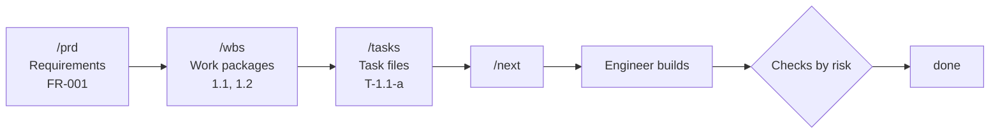

[](https://github.com/derikitz/prd-harness/actions/workflows/publish.yml)

# prd-harness

**Run your software projects with a small AI team inside Claude Code — planned from a PRD, broken down into a WBS, built and checked task by task.**

No server, no dashboard, nothing to host. Just markdown files and Claude Code features (subagents, slash commands, skills), installed into any project with one command.

```bash
npx prd-harness init
```

---

## Why

Asking an AI agent to "build the app" gives you code nobody can trace back to a requirement, and no one checking it. This kit gives Claude Code the same structure a real team uses:

- **Plan before building** — every task traces back through the WBS to a requirement in your PRD.
- **Built and checked by different agents** — an engineer builds, a tester tests, a reviewer signs off, and a security agent steps in when the task is risky.
- **Security from day one** — security questions are part of the PRD, and code is checked against the OWASP Top 10.
- **Easy on your usage limits** — checks scale with each task's risk, and agents navigate by a shared code map instead of re-exploring the codebase.

## Quick start

Requires **Node 18+** and **[Claude Code](https://claude.com/claude-code)**. Works in bash, zsh, PowerShell and cmd.

```bash
cd my-app
npx prd-harness init
claude
```

Using pnpm? Swap `npx` for `pnpm dlx` in any command here, e.g. `pnpm dlx prd-harness init`. Don't use `pnpm add prd-harness`: that only adds it as a dependency and doesn't install the harness into your project.

Then, inside Claude Code:

| New project | Existing project |
|---|---|
| `/prd` → `/wbs` → `/tasks` → `/next` | `/codedoc` → `/prd` → `/wbs` → `/tasks` → `/next` |

Already have a PRD or WBS? Convert it once with `/prd import <file>`, then `/wbs import <file>` (one combined `PRD & WBS.md` works too: pass it to both). Your originals are left untouched, and `init` lists any it finds. After that, agents read only `docs/prd.md` and `docs/wbs.md`, so the import doesn't cost extra tokens on later runs.

`init` never overwrites your files. If the project already has an `AGENTS.md` or `CLAUDE.md`, it only appends the lines that connect the workflow.

## How it works



### 1. Plan
| Step | Command | Output |
|---|---|---|
| Map the existing code *(existing projects)* | `/codedoc` | `code-doc.md` |
| Write requirements — Claude interviews you | `/prd` | `docs/prd.md` |
| Design system and screens *(optional, UI projects)* | `/design` | `docs/design.md` |
| Break requirements into deliverables | `/wbs` | `docs/wbs.md` |
| Break deliverables into tasks | `/tasks` | `tasks/todo/*.md` |

You approve the PRD before anything is built. When requirements change, run `/prd <change>` → `/wbs` → `/tasks` and the change flows down.

### 2. Build
`/next` picks the next ready task, has the **engineer** build it, then runs only the checks that task needs:

| Task risk | Example | Checks |
|---|---|---|
| `low` | Copy, styling, config values | reviewer |
| `normal` | Most feature work | tester → reviewer |
| `high` | Auth, payments, personal data, uploads, migrations | tester → security → reviewer |

If a check fails, the same engineer fixes it, and the check runs again. Task files move through `tasks/todo → doing → review → done` (or `blocked`), so the folder *is* the board.

In a git repo, every finished task becomes **one commit** — `T-1.2-a: Login form (FR-003)` — so each task can be reviewed or reverted on its own, and your history traces back to requirements. Nothing is ever pushed for you.

**Running several at once:** open more terminals and run `/next` in each. Each session claims a different task and builds it on its own branch in its own git worktree (`.claude/worktrees/session-N`, reused from task to task), so their changes don't collide. The board stays in your main checkout, so every session can see what the others are working on. Finished tasks are merged back one at a time, with no steps for you unless two tasks change the same code.

### 3. Fix bugs
`/bug <what's wrong>` logs a bug as a `B-001` task linked to the requirement it breaks — no planning round needed. Bugs go ahead of feature work of the same priority, and the tester adds a regression test for each.

### 4. Track
- `/status` — the board, what's next, progress per milestone, and traceability gaps.
- `npx prd-harness status` — the same board and gaps from your terminal, computed by a script: instant, and uses no tokens.
- `/security` — a full-project security audit; run it before each release.

## The team

| Agent | Does | Model |
|---|---|---|
| **Main session** | Project manager: owns the PRD, WBS and board, runs the others | your default |
| `engineer` | Builds one task; fixes findings from the checks; keeps `code-doc.md` current | your default |
| `tester` | Writes and runs test cases from the acceptance criteria | Sonnet |
| `security` | Deep OWASP review on high-risk tasks and audits | your default |
| `reviewer` | Final sign-off: criteria, coding rules, light security pass. Read-only | Sonnet (Haiku for low risk) |

Customize any agent — its model, your test framework, conventions — in `.claude/harness/local.md` (see [Customizing](#customizing)).

## Commands

| Command | What it does |
|---|---|
| `/codedoc [area]` | Map the codebase into `code-doc.md`, or fix entries that no longer match the code |
| `/prd [change, or import <file>]` | Create the PRD by interviewing you, import an existing one, or apply a change to it |
| `/design [screen]` | Design system and screen specs (optional) |
| `/wbs [import <file>]` | Build or update the WBS from the PRD, or import an existing one |
| `/tasks [wbs code]` | Turn work packages into task files |
| `/next [task id]` | Build, check and commit the next ready task |
| `/bug <what's wrong>` | Log a bug as a task linked to the requirement it breaks |
| `/status` | Board summary and gaps (read-only) |
| `/security [area]` | Full security audit; schedule fixes as WBS work |

## What gets installed

```
your-project/
├── AGENTS.md                 Coding rules for any AI agent (Claude, Codex, Cursor…)
├── CLAUDE.md                 Imports AGENTS.md and the workflow
├── .claude/
│   ├── agents/               engineer, tester, security, reviewer
│   ├── commands/             the slash commands above
│   ├── skills/               owasp-checklist (OWASP Top 10:2025, API, LLM)
│   └── harness/
│       ├── WORKFLOW.md       The rules of the PRD → WBS → tasks workflow
│       ├── board.js          Board script: status, ready tasks, gaps (no tokens)
│       ├── local.md          Your customizations — never overwritten
│       └── templates/        prd, design, wbs, task, code-doc, test-doc, security
├── docs/                     prd.md, wbs.md, design.md, security.md (created as you go)
└── tasks/
    ├── todo/  doing/  review/  done/  blocked/
```

Created as the work goes on: `code-doc.md` (the code map) and `test-doc.md` (test cases) in the project root.

## Tips for keeping usage low

- Check the board with `npx prd-harness status` in your terminal instead of `/status` when you only need the numbers.
- Work one task at a time with `/next`; parallel sessions use your limits proportionally faster. Use `/loop 30m /next` only when there's a queue of ready tasks — each run reads the board even when there's nothing to do.
- Keep `code-doc.md` current. If it falls behind, run `/codedoc` instead of letting each agent search the code.
- Let `/tasks` label risk honestly: most tasks should be `normal`, not `high`.

## Customizing

Put project-specific changes in **`.claude/harness/local.md`** — not in the kit's own files, which updates replace. It has a section for all agents, one per agent, and one for commands, and anything you write there overrides the kit's defaults:

```markdown
## tester
- Use Vitest. Put tests next to the file as `*.test.ts`. Run with `npm test`.

## Commands
- /next: never commit — leave changes staged for me.
```

## Updating

Re-run `init` with `--force` in a project to replace the kit's files with the latest version:

```bash
npx prd-harness@latest init --force
```

This overwrites only the kit's own files in `.claude/agents`, `commands`, `harness` and `skills`. Your `local.md`, PRD, WBS, tasks and docs are never touched.

## CLI reference

```
prd-harness init [dir] [--force]     Install the harness into a project
prd-harness status [dir] [--json]    Show the board, ready tasks and traceability gaps

  dir         Project folder (default: current folder)
  --force     init: overwrite the kit's files with this version
  --json      status: machine-readable output
  --help      Show help
  --version   Show version
```

---

## Contributing / maintaining

Edit the files in this repo — they *are* the kit. `bin/cli.js` copies them into projects.

```bash
npm link                         # once: makes `prd-harness` available everywhere
prd-harness init ../some-test-project

npm pack --dry-run               # check what will be published
```

### Releasing
Releases are published to npm by GitHub Actions (`.github/workflows/publish.yml`) when a version tag is pushed:

```bash
npm version patch                # or minor / major — bumps package.json and creates the tag
git push --follow-tags
```

The workflow checks that the tag matches `package.json`, smoke-tests the CLI, then publishes with [npm trusted publishing](https://docs.npmjs.com/trusted-publishers) — no npm token is stored in GitHub, and every release gets a provenance badge.

## License

MIT
